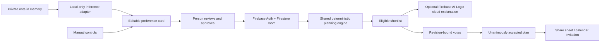

# Architecture and data boundaries

## Topology

Web uses JavaScript/CSS bundled with esbuild. iOS is rendered with native SwiftUI, and Android with native Jetpack Compose. `shared/design-tokens.json` generates style constants for all three; catalogue JSON, photographs and Inter font files are bundled with each app. The native Swift and Kotlin planners are verified against shared web-generated fixtures.

Native Firebase repositories implement the same atomic room, member, option and vote operations as web. Native views keep private notes in temporary view state and explicitly build approved-card payloads. External venue navigation uses the system browser. Private prompts and App Check tokens are not logged.

## AI responsibilities

| Work | Execution | Inputs | Failure behavior |
| --- | --- | --- | --- |
| Interpret private note | Local Firebase AI Logic adapter | Note and existing card | Manual controls; no upload fallback |
| Validate a card | Shared local code | Typed card | Reject unsupported fields/types/ranges |
| Enforce hard limits | Shared local code | Approved cards and catalogue | Explain no feasible options |
| Rank group choices | Shared local code | Eligible candidates | Stable deterministic ordering |
| Explain shortlist | Firebase AI Logic cloud model | Allowlisted shared cards and top candidates | Shortlist remains usable without explanation |
| Confirm plan | Firestore rules plus client check | Current proposal and current member votes | Deny until unanimous |

The cloud model does not own permissions, plan eligibility, votes or confirmation. JSON output is treated as untrusted. Unknown candidate IDs, duplicates, missing fields, oversized strings and invalid cards are rejected. All model text is inserted as escaped text.

## Platform adapters

Web uses the Firebase JavaScript SDK’s `ONLY_ON_DEVICE` mode for notes and `ONLY_IN_CLOUD` for disclosed explanations. Android uses `firebase-ai` plus `firebase-ai-ondevice` with `InferenceMode.ONLY_ON_DEVICE`. iOS uses Firebase’s iOS 26 system model session with no secondary cloud model.

Capability detection is separate from successful inference. A device being eligible is not evidence that the model actually ran. Inference receipts appear only after a real successful response. Local receipt data is session-only and contains provider, execution kind, elapsed time and timestamp; it excludes prompts and responses.

## Data model

`rooms/{roomId}` contains title, date, city, owner ID, member ID list, lifecycle status, revision, proposal, invitation token reference and creation timestamp. Room IDs contain 144 random bits; invitation tokens contain 192 random bits. Invitation tokens act as capabilities and should be shared intentionally.

`rooms/{roomId}/members/{uid}` contains a bounded display name, approved card, original invitation reference and update timestamp. This is shared room data, not a private user profile. There are no email, exact-location or raw-note fields.

`rooms/{roomId}/votes/{uid}` contains choice, candidate ID, proposal revision and update timestamp. Only that authenticated member may write it. Votes are meaningful only for the exact active revision.

`rooms/{roomId}/options/option-01` through `option-12` contain bounded host-provided activity fields, author UID and timestamp. Fixed slots bound the collection to twelve activities. Host edits must atomically reopen the decision. Their data is a human-provided estimate, not a live third-party feed.

`invites/{token}` contains room ID, title, owner ID and expiry. Authenticated clients can retrieve a known unexpired token. Listing tokens is denied. Joining atomically creates membership and appends only the caller’s own UID to the room; an invitation cannot grant access to another room.

Firestore’s date string validation is format-only. The client validates the calendar date for normal use. Server-controlled timestamps are used for creation, expiry and updates. No composite index is required for the membership `array-contains` query.

## Revision protocol

A member-card write, activity write or new membership increments the room revision and clears its proposal. Proposing an activity increments the revision again. Votes contain the proposal revision and candidate ID. Confirming changes only `status`; the rules read each member’s current vote. The maximum group size of eight keeps consensus checks bounded.

The engine checks feasibility on every client, including immediately before proposing or confirming. Firestore rules enforce schemas, membership, host authority and consensus; they do not independently calculate geographical travel or re-run the full recommendation score. A future trusted backend can attest candidate feasibility if hostile-host resistance becomes a product requirement.

## Firebase services

- **Authentication:** anonymous sign-in for low-friction participation. No cloud password or identity fields are stored in room documents.
- **Firestore:** room subscriptions, approved cards, bounded host options and revision-bound votes.
- **AI Logic:** actual SDK calls in running adapters, with separate local-only and disclosed cloud paths.
- **App Check:** web reCAPTCHA Enterprise; native Firebase SDK providers use App Attest or Play Integrity, with development-only debug providers and private tokens.
- **Remote Config:** explicit cloud model, explanation kill switch and UI group limit defaults. Rules independently cap room membership at eight.
- **Hosting:** static compiled app, security headers and service-worker cache policy. No server-side model key is embedded.

No paid billing plan is enabled by the setup helper. A production venue/routing proxy or background functions may require a separate billing decision.

## Offline behavior

The web service worker caches application assets and shared fonts only. It excludes Firebase API traffic, invitation queries and local Firebase configuration. Native applications bundle the catalogue, fonts and photographs, and keep local rooms in platform preferences. Local rooms, deterministic planning and manual controls work without network access. Live state needs connectivity.

Raw notes are in memory only. Approved defaults and sample rooms use local storage and can be cleared in Settings. This first version does not provide server-side room deletion or anonymous identity recovery; these are explicitly deferred release requirements.

## Prototype rules review

The emulator suite covers unauthenticated and outsider reads, invite enumeration, guessed and cross-room capabilities, partial joins, membership injection, ownership changes, oversized and polluted cards, missing atomic resets, vote impersonation, stale acceptance, host authority, all-eight-member confirmation and the exact room query used by the client.

The rules remain a prototype requiring review before broad release. Tests cover specific behaviors and do not constitute an exhaustive security guarantee. App Check enforcement, service quotas, retention and production identity providers must also be verified against the deployed project.
